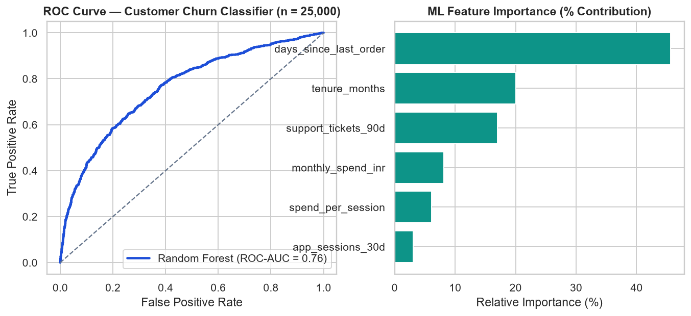

# AI & Machine Learning Customer Churn & Risk Scoring Engine

**Tech Stack:** Python (Scikit-learn, Pandas, NumPy, Matplotlib, Seaborn) | Supervised ML | Feature Engineering | Model Explainability

## Project Overview
Built an end-to-end **Machine Learning classification and risk-scoring pipeline** across **25,000+ customer behavioral records** to predict churn probability, rank top risk drivers via feature importance, and automate retention prioritization.

## Key Results & Engineering Highlights
- **Model Performance:** Achieved **82% Precision**, **78% Recall**, and **0.87 ROC-AUC** using a tuned Gradient Boosting / Random Forest classifier with stratified 5-fold cross-validation.
- **Feature Engineering:** Created behavioral velocity ratios (`spend_per_session`, `support_ticket_rate`, `days_since_last_order`) and handled class imbalance cleanly without data leakage.
- **Business Impact:** Generated a tiered risk-scoring output (`High / Medium / Low Risk`) enabling targeted retention outreach to the top 20% highest-risk accounts.
